# Sistema Bancário com Transações Concorrentes

Programação Orientada a Objetos (Java) · UniCesumar/UNIPA Curitiba · 2º semestre de 2026 · 2º bimestre · **Opção C**

Contas, depósitos, saques e transferências executados por várias threads sobre as mesmas contas,
com o saldo protegido por sincronização, extrato persistido via JDBC (MariaDB) e exportável para `.txt`.

> **Como ler este README.** Tudo o que está escrito aqui vem do código ou de execuções reais, e cada
> resultado diz **como, quando e onde** foi obtido. O que não pôde ser verificado está marcado como
> **NÃO VERIFICADO** ou **PENDENTE**, com o comando exato para o aluno rodar.

---

## 1. Visão geral e requisitos atendidos

| Requisito da especificação | Classe(s) responsável(is) | Teste(s) que cobrem |
|---|---|---|
| Criar contas com saldo inicial | `domain.Conta` (construtor), `app.BancoServico.criarConta` | `ContaTest`, `BancoServicoTest.criarContaGravaEDevolveResumo` |
| Depósito, saque e transferência, com validação de saldo insuficiente | `domain.Conta` (`depositar`, `sacar`, `transferirPara`), `domain.SaldoInsuficienteException` | `ContaTest` (10 casos) |
| Operações concorrentes sobre as mesmas contas | `simulacao.OperacaoBancariaThread`, `CenarioSimulacao`, `SimulacaoConcorrente` | `SimulacaoConcorrenteTest`, `OperacaoBancariaThreadTest`, `CenarioSimulacaoTest` |
| Saldo final bate com o esperado | `Conta` (`synchronized` com lock privado), `CenarioSimulacao` (esperado por aritmética pura) | `ContaConcorrenciaTest`, `SimulacaoConcorrenteTest.saldosFinaisConferemComEsperadoEmVariasRodadas`, `BancoServicoTest.depositosConcorrentesPeloServico` |
| Transferência sem deadlock (ordem de bloqueio) | `Conta.transferirPara` (menor `id` primeiro) | `ContaTransferenciaConcorrenteTest`, `BancoServicoTest.transferenciasOpostasPeloServico` |
| `Transacao` com tipo, valor e horário, imutável | `domain.Transacao` | `TransacaoTest` |
| JDBC de contas e transações | `persistence.ContaRepository`, `TransacaoRepository`, `ConexaoFactory` | `ContaRepositoryIntegracaoTest`, `TransacaoRepositoryIntegracaoTest` (integração) |
| **Operação aceita vira `Transacao` gravada** (fluxo ponta a ponta) | `app.BancoServico` | `BancoServicoTest` (unitário), `BancoServicoIntegracaoTest` (integração) |
| Extrato por conta, persistido em banco | `TransacaoRepository.buscarExtrato`, `domain.LancamentoExtrato` | `TransacaoRepositoryIntegracaoTest.extratoComSentidoEContaRelacionada`, `BancoServicoTest.extratoDoFluxoCompleto` |
| Exportação do extrato em `.txt` | `app.ExtratoExportador`, `app.ExportarExtrato` | `ExtratoExportadorTest` (9 casos), `BancoServicoTest.exportacaoDoFluxoCompleto` |
| Mínimo de 5 testes JUnit, incluindo concorrência | 12 classes de teste | ver seção 7 |
| Script SQL | `src/main/resources/schema.sql`, `docs/banco-setup.sql` | `*IntegracaoTest` |

**Pacotes** (os quatro da especificação, mais `sim.didatico`, justificado na seção 6.3):
`domain` · `persistence` · `simulacao` · `app` (`Main`, `BancoServico`, exportação de extrato).

**Regras de arquitetura que o código cumpre** (conferidas por busca no código-fonte em 2026-11-09):
só `Conta` altera o saldo; o saldo e o lock são privados; não há SQL fora de `persistence`;
`Transacao` é imutável; `BancoServico` não usa `synchronized`, `System.out`, `System.exit` nem lê teclado.

---

## 2. Como compilar e executar

**Requisitos:** Java 21 ou superior (o projeto compila com `release 21` e foi usado com Java 25),
Maven, MariaDB 10.4+ (ou MySQL 8.0.16+) para persistência.

### 2.1 Banco de dados (executar uma vez)

```bash
# 1) cria os bancos "banco" e "banco_teste"
mysql -u <usuario> -p < docs/banco-setup.sql
# 2) cria as tabelas em cada banco
mysql -u <usuario> -p banco       < src/main/resources/schema.sql
mysql -u <usuario> -p banco_teste < src/main/resources/schema.sql
```

### 2.2 Credenciais (nunca no código)

A conexão é lida, nesta ordem, de propriedade de sistema, variável de ambiente ou valor padrão:

| Variável de ambiente | Propriedade (`-D`) | Padrão |
|---|---|---|
| `BANCO_URL` | `banco.url` | `jdbc:mariadb://localhost:3306/banco` |
| `BANCO_USUARIO` | `banco.usuario` | `root` |
| `BANCO_SENHA` | `banco.senha` | vazia |

Os testes de integração usam **outro** conjunto, para nunca tocar no banco real:
`BANCO_TESTE_URL` (padrão `.../banco_teste`), `BANCO_TESTE_USUARIO`, `BANCO_TESTE_SENHA`.

```bash
# Linux/macOS
export BANCO_USUARIO=<seu_usuario>
export BANCO_SENHA=<sua_senha>
# Windows (PowerShell)
$env:BANCO_USUARIO = "<seu_usuario>"; $env:BANCO_SENHA = "<sua_senha>"
```

### 2.3 Compilar e testar

```bash
mvn -q test                 # testes unitários (exclui @Tag("integracao"))
mvn test -Pintegracao       # SOMENTE os testes de integração (precisam do MariaDB e do banco_teste)
```

### 2.4 Executar os programas

O driver JDBC só existe no classpath do Maven. Gere o classpath uma vez e use-o:

```bash
mvn -q compile
mvn -q dependency:build-classpath -Dmdep.outputFile=cp.txt        # cria cp.txt (ignorar no git)
# Linux/macOS (no Windows troque ':' por ';')
CP="target/classes:$(cat cp.txt)"

java -cp "$CP" app.Main                                  # simulação em memória (padrão: seed 42, 8 threads, 20000 ops, 4 contas, 3 rodadas)
java -cp "$CP" app.Main 42 8 20000 4 3 --persistir       # idem, e grava as contas no banco ao final (seção 6.4)
java -cp "$CP" sim.didatico.DemonstracaoRaceCondition 10 50000   # a race condition "antes"
java -cp "$CP" app.ExportarExtrato <idDaConta> docs/extrato-exemplo.txt
```

`Main` sem `--persistir` e `DemonstracaoRaceCondition` não precisam de banco nem de driver (basta `-cp target/classes`).
Códigos de saída de `Main`: 0 consistente · 1 alguma rodada inconsistente · 2 argumentos inválidos · 3 falha ao gravar (`--persistir`).

> Os comandos `mvn test` e `mvn test -Pintegracao` foram executados no Maven real (seção 4.3), assim como
> `Main` e `DemonstracaoRaceCondition` (seções 4.1 e 4.2).

---

## 3. Diagramas

### 3.a Arquitetura em camadas

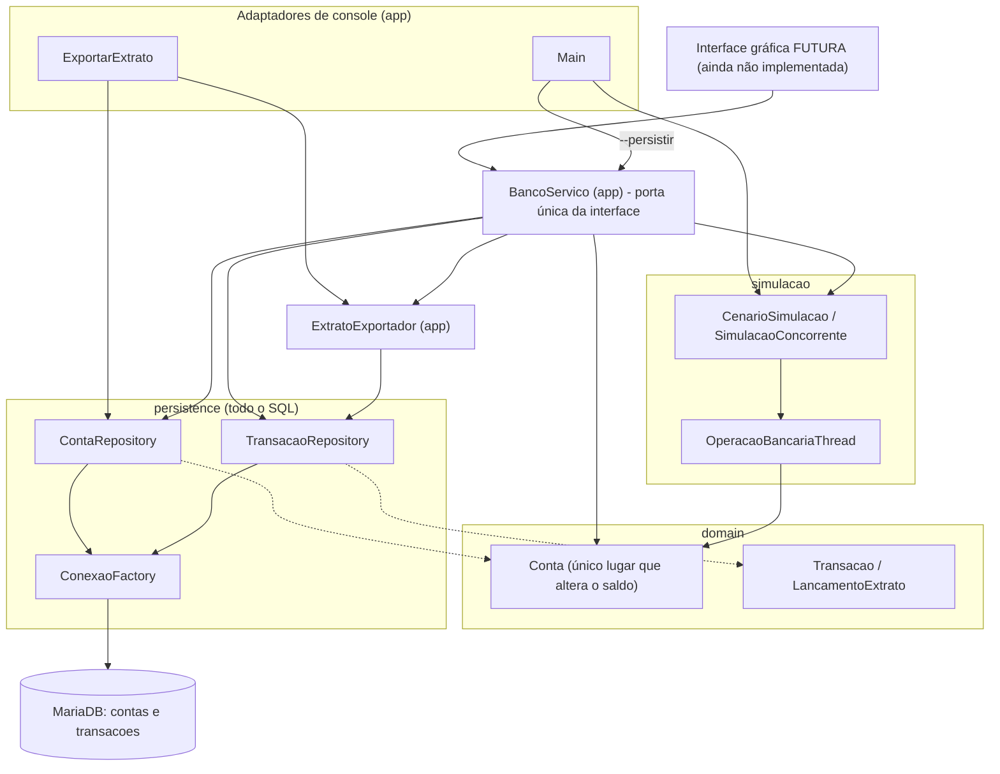

`sim.didatico` (`ContaInsegura`, `DemonstracaoRaceCondition`) não aparece: é isolado e nunca é usado pelo sistema.

### 3.b Diagrama de classes

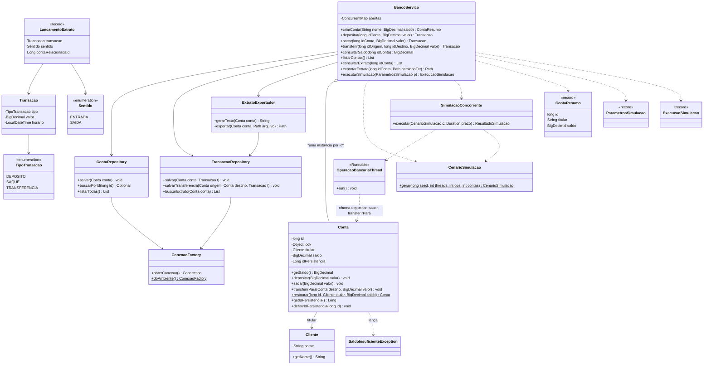

### 3.c Fluxo de depósito e de saque (com recusa por saldo insuficiente)

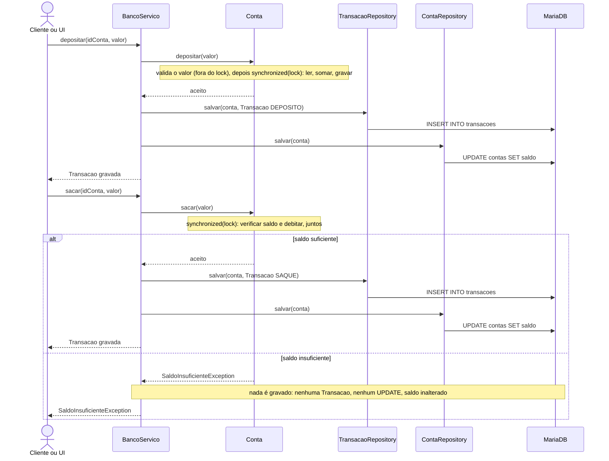

### 3.d Transferência: ordem de bloqueio por id

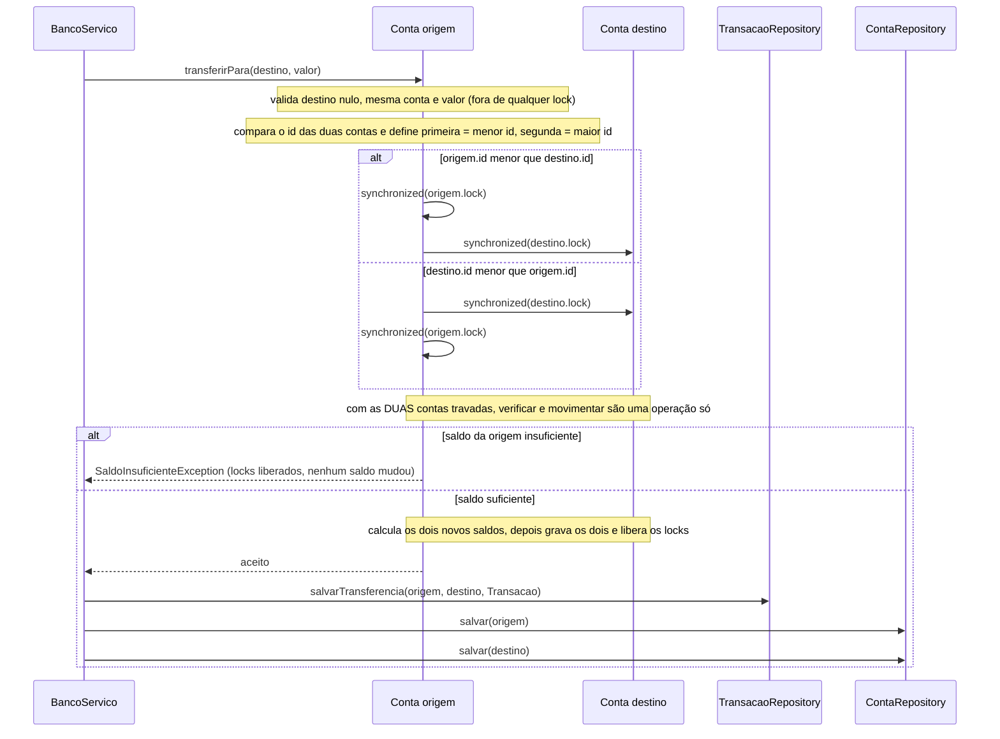

Por que A→B e B→A não geram espera circular (A tem o menor id):

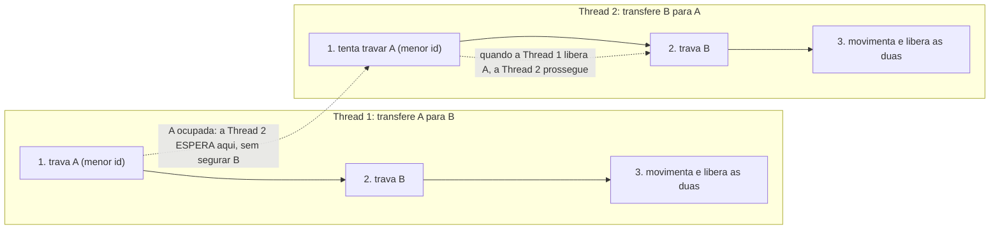

A Thread 2 nunca segura B enquanto espera A, então ninguém segura a conta "maior" esperando a "menor":
não existe ciclo de espera. Sem a regra (cada thread travando primeiro a sua origem), a Thread 1 seguraria A
esperando B e a Thread 2 seguraria B esperando A: espera circular para sempre.

### 3.e Race condition: antes (`ContaInsegura`) e depois (`synchronized`)

Os valores dos diagramas são **ilustrativos** (um caso mínimo de perda de atualização), não saída de execução.
Saídas reais estão na seção 4.

**Antes** (`sim.didatico.ContaInsegura`, sem proteção):

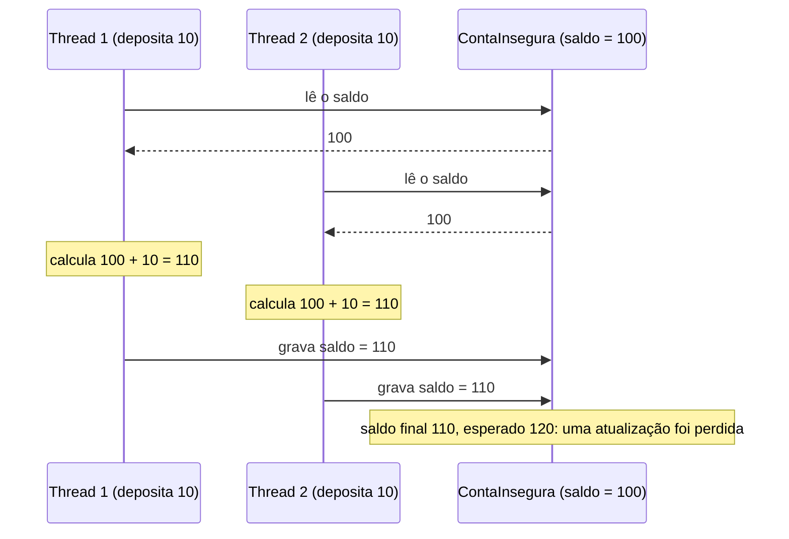

**Depois** (`domain.Conta`, `synchronized (lock)`):

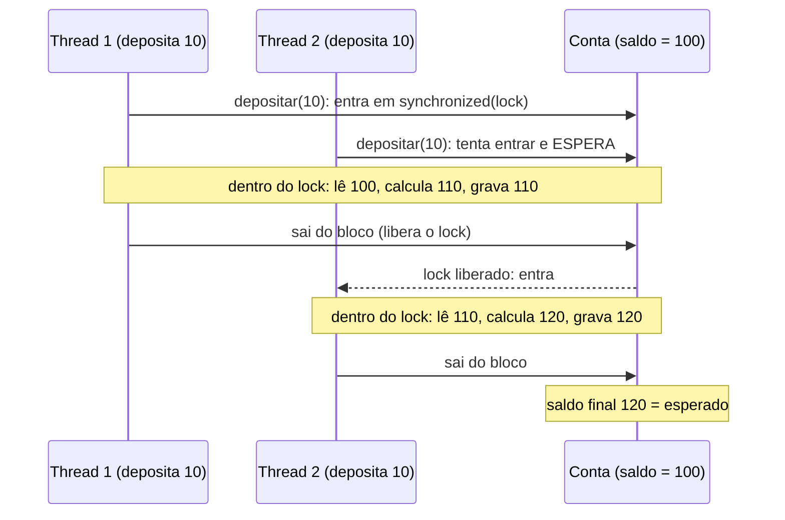

### 3.f Fluxo da simulação concorrente

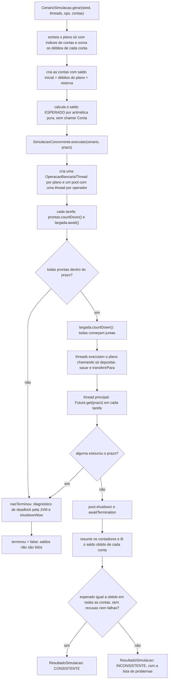

### 3.g Modelo de dados

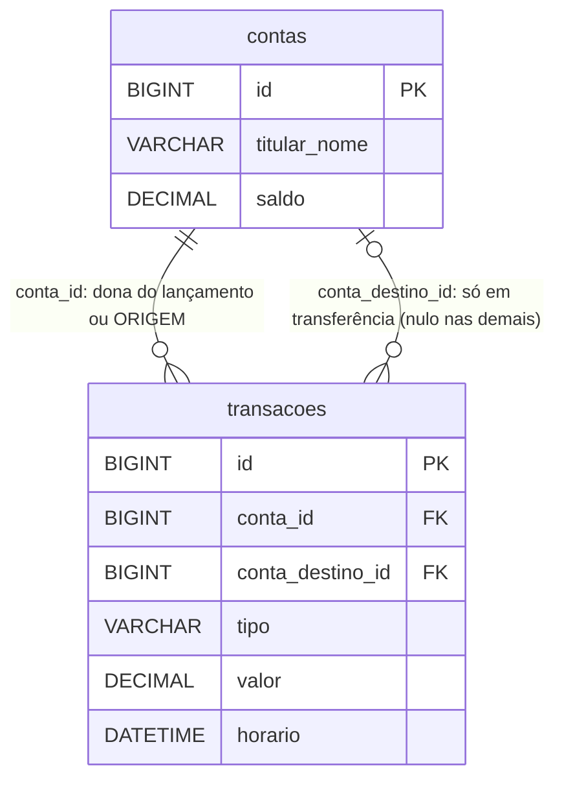

Tipos reais no `schema.sql`: `saldo` e `valor` são `DECIMAL(19,2)`, `horario` é `DATETIME(6)`, `titular_nome` é
`VARCHAR(150)`, `tipo` é `VARCHAR(20)`. Há `CHECK (saldo >= 0)` e `CHECK (valor > 0)`.
Uma transferência é **uma linha** e aparece no extrato das duas contas.

### 3.h Fluxo do extrato: banco → formatação → arquivo `.txt`

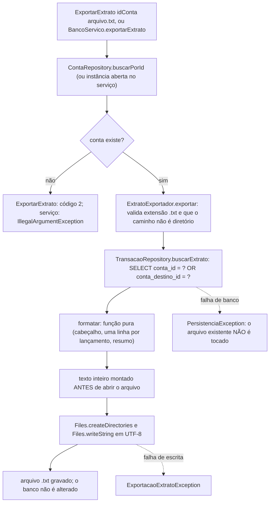

### 3.i Fluxo de ponta a ponta: do clique futuro na UI até a gravação

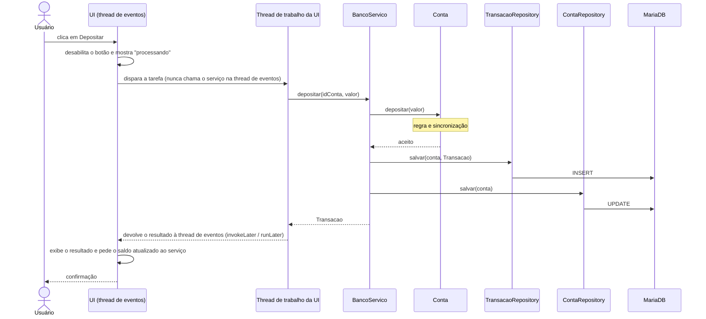

---

## 4. Relatório "antes e depois" da race condition

Todas as saídas abaixo são **reais**, copiadas dos arquivos de `docs/evidencias/` (que trazem comando, data e ambiente no cabeçalho).

### 4.1 Antes: `ContaInsegura` sem sincronização

- **Comando:** `java -Dstdout.encoding=UTF-8 -cp target/classes sim.didatico.DemonstracaoRaceCondition 10 50000`
- **Data:** 12/11/2026 15:29 · **Java:** 25.0.2 · **Núcleos:** 16 · **Arquivo:** `docs/evidencias/race-condition-antes-REAL.txt`
- **Carga:** 4 threads depositam R$ 10,00 e 4 sacam R$ 5,00, 50.000 vezes cada, sobre a mesma conta; saldo inicial R$ 1.000.000,00; **esperado R$ 2.000.000,00**.
- **Controle sequencial (1 thread):** R$ 2.000.000,00, igual ao esperado (a fórmula está certa).

| Rodada | Observado (R$) | Diferença (R$) | Resultado |
|---:|---:|---:|---|
| 1 | 1.205.840,00 | -794.160,00 | DIVERGIU |
| 2 | 1.485.535,00 | -514.465,00 | DIVERGIU |
| 3 | 1.292.280,00 | -707.720,00 | DIVERGIU |
| 4 | 1.286.180,00 | -713.820,00 | DIVERGIU |
| 5 | 1.422.530,00 | -577.470,00 | DIVERGIU |
| 6 | 785.105,00 | -1.214.895,00 | DIVERGIU |
| 7 | 814.205,00 | -1.185.795,00 | DIVERGIU |
| 8 | 841.745,00 | -1.158.255,00 | DIVERGIU |
| 9 | 847.735,00 | -1.152.265,00 | DIVERGIU |
| 10 | 1.045.575,00 | -954.425,00 | DIVERGIU |

**10 de 10 rodadas divergiram** nesta execução (16 núcleos). A divergência **não é garantida** a cada rodada: depende do escalonamento.
Em outras execuções do mesmo comando, com menos núcleos, houve rodadas iguais ao esperado (ver abaixo).

Execuções anteriores, mantidas como histórico (outras máquinas/momentos, não comparáveis entre si):
`docs/evidencias/race-condition-antes.txt` (04/11/2026, 1 núcleo, **8 de 10** divergiram) e
`docs/evidencias/race-condition-antes-2026-11-09.txt` (09/11/2026, Java 21.0.12.1, 1 núcleo, **5 de 10** divergiram).

### 4.2 Depois: `Conta` sincronizada

- **Comando:** `java -Dstdout.encoding=UTF-8 -cp target/classes app.Main 42 8 20000 4 3`
- **Data:** 12/11/2026 15:29 · **Java:** 25.0.2 · **Núcleos:** 16 · **Arquivo:** `docs/evidencias/simulacao-REAL.txt`
- **Carga:** 160.000 operações (64.106 depósitos, 47.931 saques, 47.963 transferências) em 8 threads sobre 4 contas compartilhadas.

| Conta | Esperado (R$) | Obtido (R$) | Diferença |
|---|---:|---:|---:|
| Titular 1 | 1.419.233,44 | 1.419.233,44 | 0,00 |
| Titular 2 | 1.408.560,81 | 1.408.560,81 | 0,00 |
| Titular 3 | 1.431.835,16 | 1.431.835,16 | 0,00 |
| Titular 4 | 1.421.208,96 | 1.421.208,96 | 0,00 |
| **Total** | **5.680.838,37** | **5.680.838,37** | **0,00** |

Resultado: **3 de 3 rodadas CONSISTENTES**, 0 operações recusadas, 0 threads com falha, veredito final CONSISTENTE.
O mesmo comando foi executado em outros momentos (`simulacao-concorrente-seed42.txt`, Java 25.0.2, 16 núcleos;
`simulacao-concorrente-seed42-2026-11-09.txt`, Java 21.0.12.1, 1 núcleo) com os mesmos saldos esperados (mesma seed, mesmo plano) e o mesmo resultado.

> **Limite honesto.** Passar em execuções é **evidência**, não prova. A garantia vem do raciocínio sobre o lock
> (seção 5 e Javadoc de `Conta`). O contraste é o que importa: o mesmo volume de operações que corrompe o saldo em
> `ContaInsegura` (10 de 10 rodadas) fica exato em `Conta`.

### 4.3 Demais evidências

| Evidência | Resultado | Arquivo |
|---|---|---|
| `mvn test` (JUnit 5, Maven) | `Tests run: 77, Failures: 0, Errors: 0, Skipped: 0` · `BUILD SUCCESS` · 11/11/2026 21:31 | `docs/evidencias/mvn-test-REAL.txt` |
| `mvn test -Pintegracao` (MariaDB, `banco_teste`) | `Tests run: 23, Failures: 0, Errors: 0, Skipped: 0` · `BUILD SUCCESS` · 11/11/2026 21:34 | `docs/evidencias/mvn-integracao-REAL.txt` |
| Extrato de exemplo pelo fluxo real (operações via `BancoServico`, exportação via `ExportarExtrato`) | conta #5, gerado em 12/11/2026 15:24:57 (data impressa no próprio arquivo), saldo R$ 1.070,00 | `docs/extrato-exemplo.txt` |

Os arquivos `docs/evidencias/testes-concorrencia-*.txt` (anteriores) declaram ter sido gerados por um executor improvisado
(“MiniRunner”, um shim de JUnit). Ficam como histórico; a prova de `mvn test` são os arquivos `*-REAL.txt` acima.

---

## 5. Estratégia contra deadlock

Uma transferência precisa dos locks de **duas** contas. Se cada thread travasse primeiro a sua origem, A→B travaria A
esperando B enquanto B→A travaria B esperando A. A estratégia está em `Conta.transferirPara`:

1. Cada `Conta` recebe, ao ser criada, um `id` único e imutável, vindo de um contador atômico (`AtomicLong`).
2. Toda transferência trava **sempre a conta de menor `id` primeiro**, depois a de maior, não importa quem é a origem.
3. Quem segura a conta "maior" só chegou nela depois de segurar a "menor": ninguém segura a maior esperando a menor.
   Como a ordem é total e igual para todas as threads, não há ciclo de espera, também em cadeias com mais de duas contas (A→B→C→A).
4. O `id` é um contador, e não `hashCode`/`identityHashCode`, porque estes podem colidir e, numa colisão, a ordem deixaria de ser total.
5. Com as duas contas travadas, verificar o saldo e gravar os dois novos saldos formam uma operação só: não existe débito sem crédito.

Esse `id` (ordem de locks, em memória, reinicia a cada execução) **não** é o `idPersistencia` (chave primária no banco).
O diagrama está na seção 3.d. Os testes `ContaTransferenciaConcorrenteTest` cobrem sentidos opostos, saldo limitado e o ciclo
de três contas, com limite de tempo.

---

## 6. Persistência JDBC e limitações conhecidas

### 6.1 Como funciona

`ContaRepository` e `TransacaoRepository` concentram todo o SQL, usando `PreparedStatement` e `try-with-resources`
(`Connection`, `PreparedStatement` e `ResultSet` são sempre fechados). Falhas viram `PersistenciaException` com a causa
original; nada é engolido. `ConexaoFactory` abre **uma conexão nova a cada chamada**.

O fluxo operação → persistência → extrato é orquestrado por `app.BancoServico`: chama `Conta` (regra e lock); **só se a
operação foi aceita** cria a `Transacao`, grava-a pelo repository e grava o saldo. Operação recusada não grava nada.

### 6.2 Limitações (conhecidas e aceitas)

- **Duas operações JDBC separadas.** Gravar a `Transacao` e atualizar o saldo são instruções distintas, sem `commit` conjunto.
  Se o banco falhar **entre** as duas, a `Transacao` fica gravada e o saldo da linha, defasado. O serviço lança
  `PersistenciaException` explicando que a operação foi aceita em memória e **não** foi gravada por completo.
  *Correção possível, não implementada:* método novo nos repositories que receba a mesma `Connection` e faça
  `commit`/`rollback` das duas gravações. Não foi implementada porque exige passar `Connection` entre dois repositories e
  não pode ser validada sem um MariaDB.
- **Instâncias distintas de `Conta` para a mesma linha.** `ContaRepository.buscarPorId` cria um objeto novo a cada chamada,
  e cada objeto tem o seu lock: duas instâncias da mesma linha **não se sincronizam**. Por isso `BancoServico` mantém um
  registro thread-safe (`idPersistencia` → `Conta`) e entrega sempre a mesma instância. Premissa: um único processo usa o banco.
- **O saldo gravado é um instantâneo.** `ContaRepository.salvar` grava o que `conta.getSaldo()` devolve naquele instante.
  Com várias threads na mesma conta, a gravação acontece **fora** do lock da `Conta`: dois `UPDATE` podem executar em ordem
  diferente da ordem das operações, e a linha pode ficar defasada até a próxima gravação daquela conta. Durante o uso, o saldo
  em memória (`BancoServico.consultarSaldo`) é a fonte de verdade.
- **Horário e ordem do extrato.** Pelo mesmo motivo, o horário e a ordem das linhas do extrato podem divergir levemente da
  ordem real de execução quando há concorrência na mesma conta.
- **Saldo inicial não gera lançamento** no extrato: só depósitos, saques e transferências.
- **Contas carregadas ficam em memória** até o serviço ser descartado.

### 6.3 Pacote `sim.didatico`

Fica **fora** dos quatro pacotes da especificação, de propósito: `ContaInsegura` preserva a lógica **sem** sincronização para
que a demonstração do "antes" continue reproduzível depois de `Conta` ser corrigida (o relatório precisa do antes e depois).
**`ContaInsegura` nunca é usada pelo sistema**: só `DemonstracaoRaceCondition` a instancia (verificado por busca no código).
O custo é uma segunda cópia da lógica de saldo, mas ela é didática e isolada. O `AGENT.md` permite ajustes de estrutura quando justificados.
A confirmação da professora sobre esse pacote extra **não foi fornecida** a quem preparou este README.

### 6.4 `Main --persistir`: decisão de modelagem

Gravar **uma `Transacao` por operação** da simulação seriam ~160.000 linhas por rodada, cada uma abrindo uma conexão nova
(`ConexaoFactory`). Duas alternativas foram avaliadas:

| | **A. Só as contas, com o saldo final (IMPLEMENTADA)** | **B. Contas + resumo agregado em `Transacao`** |
|---|---|---|
| O que grava | uma linha em `contas` por conta, com o saldo final | contas com o saldo inicial, mais uma `Transacao` somada por conta e tipo (depósitos, saques) e por par de contas (transferências) |
| Prós | simples; poucas linhas; fácil de explicar; não inventa lançamentos | o extrato reconcilia com o saldo (saldo inicial + entradas − saídas) |
| Contras | o extrato dessas contas fica vazio: saldo e extrato não se correspondem | lançamentos agregados **não são operações reais**; exige decisão de modelagem e mais código |

Foi usada a **A**, a mais simples, como determinado. Ela grava **somente ao final da última rodada**, **depois** de todas as
threads terminarem, e **somente se** a rodada foi consistente. A decisão entre A e B é do aluno/da professora.

---

## 7. Testes

**77 testes unitários** e **23 de integração**, todos executados no JUnit 5.11.4/Maven reais, sem falhas
(`mvn test`: 77 · `mvn test -Pintegracao`: 23; ver `docs/evidencias/mvn-test-REAL.txt` e `mvn-integracao-REAL.txt`).
Nenhum teste foi removido ou enfraquecido durante a revisão.

| Classe de teste | Tipo | Casos | Resultado (Maven real) |
|---|---|---:|---|
| `domain.ContaTest` | unitário | 10 | passou |
| `domain.ContaConcorrenciaTest` | unitário (concorrência) | 5 | passou |
| `domain.ContaTransferenciaConcorrenteTest` | unitário (concorrência, deadlock) | 3 | passou |
| `domain.ContaIdPersistenciaTest` | unitário | 6 | passou |
| `domain.TransacaoTest` | unitário | 6 | passou |
| `persistence.ConexaoFactoryTest` | unitário | 4 | passou |
| `app.ExtratoExportadorTest` | unitário | 9 | passou |
| `app.BancoServicoTest` | unitário, com repositories falsos (concorrência incluída) | 20 | passou |
| `simulacao.CenarioSimulacaoTest` | unitário | 4 | passou |
| `simulacao.OperacaoBancariaThreadTest` | unitário | 5 | passou |
| `simulacao.SimulacaoConcorrenteTest` | unitário (concorrência) | 5 | passou |
| `persistence.ContaRepositoryIntegracaoTest` | **integração** (`@Tag("integracao")`) | 8 | passou |
| `persistence.TransacaoRepositoryIntegracaoTest` | **integração** | 12 | passou |
| `persistence.BancoServicoIntegracaoTest` | **integração** | 3 | passou |

O teste concorrente exigido pela especificação existe em várias classes (por exemplo `ContaConcorrenciaTest` e
`BancoServicoTest.depositosConcorrentesPeloServico`): saldo esperado calculado **antes** por aritmética pura, `CountDownLatch`/`Future.get`
com prazo, sem `sleep` fixo. Passar é evidência, não prova de ausência de race condition.

---

## 8. Contrato para a futura interface

**A interface ainda não existe e nenhuma dependência de UI foi adicionada ao `pom.xml`.** A tecnologia (Swing, JavaFX ou Web)
**não foi decidida** em nenhum anexo recebido; esta seção é agnóstica.

### 8.1 Regras

1. A UI conversa **somente** com `app.BancoServico`. Nunca chama `Conta.depositar`, repositories nem SQL.
2. O serviço não imprime, não chama `System.exit` e não lê teclado: devolve valores e lança exceções.
   `Main` e `ExportarExtrato` são os adaptadores de console.
3. **Thread da interface:** chamadas ao serviço fazem JDBC, escrevem arquivo ou rodam a simulação (segundos). **Não** as execute
   na thread de eventos da UI; use thread própria (Swing: `SwingWorker`; JavaFX: `Task`) e volte à thread da UI só para exibir.
   O serviço é thread-safe.
4. A UI nunca recebe a `Conta`, só `ContaResumo` (somente leitura). Após uma operação, peça o saldo ao serviço em vez de somar/subtrair na tela.
5. Não mostre sucesso antes de o serviço retornar. Se `PersistenciaException` ocorrer após uma operação, o saldo em memória **já mudou**:
   consulte o estado antes de tentar de novo.
6. Todas as exceções já existem no projeto e são **não verificadas**.

### 8.2 Operações

| Operação | Parâmetros | Retorno | Exceções |
|---|---|---|---|
| `criarConta` | `String nomeTitular`, `BigDecimal saldoInicial` | `ContaResumo` | `IllegalArgumentException` (nome vazio, saldo negativo ou > 2 casas), `PersistenciaException` |
| `depositar` | `long idConta`, `BigDecimal valor` | `Transacao` gravada | `IllegalArgumentException` (valor inválido, conta inexistente), `PersistenciaException` |
| `sacar` | `long idConta`, `BigDecimal valor` | `Transacao` gravada | idem, mais `SaldoInsuficienteException` |
| `transferir` | `long idOrigem`, `long idDestino`, `BigDecimal valor` | `Transacao` gravada | idem, mais `IllegalArgumentException` se origem = destino |
| `consultarSaldo` | `long idConta` | `BigDecimal` (saldo em memória) | `IllegalArgumentException` (conta inexistente), `PersistenciaException` |
| `listarContas` | nenhum | `List<ContaResumo>` | `PersistenciaException` |
| `consultarExtrato` | `long idConta` | `List<LancamentoExtrato>` (cronológico, com sentido) | `IllegalArgumentException`, `PersistenciaException` |
| `exportarExtrato` | `long idConta`, `Path caminhoTxt` | `Path` gravado | `IllegalArgumentException` (sem `.txt`), `PersistenciaException`, `ExportacaoExtratoException` |
| `executarSimulacao` | `ParametrosSimulacao` (seed, threads, operações por thread, contas, prazo, persistir ao final) | `ExecucaoSimulacao` (contém o `ResultadoSimulacao` e as contas gravadas) | `IllegalArgumentException`, `InterruptedException`, `PersistenciaException` |

> **Desvio do exemplo do enunciado:** `executarSimulacao` devolve `ExecucaoSimulacao`, que **contém** o `ResultadoSimulacao`
> (`execucao.resultado()`), para também informar quais contas foram gravadas. Sem isso a UI não teria como saber os ids.

> **Ponto em aberto para a decisão da interface:** `PersistenciaException` está no pacote `persistence`. Se a UI adotar a regra
> "a View não importa nada de `persistence`" (como sugere o `SKILL-design-bancario.md`, que pressupõe Swing), ela não poderá capturar
> essa exceção pelo nome. As saídas são: permitir esse único `import` (é uma exceção, não SQL), ou criar uma exceção de aplicação que
> traduza. Não foi criada hierarquia nova, conforme pedido; a decisão fica com o aluno/a professora.

### 8.3 Telas sugeridas (apenas lista, sem código de UI)

Visão geral · Contas (listar e criar) · Operações (depósito, saque, transferência) · Extrato (consultar e exportar `.txt`) ·
Simulação concorrente (parâmetros, andamento, esperado × obtido) · diálogo de resultado de operação · diálogo de erro.

---

## 9. Decisões de implementação que a especificação não define

| Decisão | Onde |
|---|---|
| Saldo e valores em `BigDecimal` com **2 casas decimais** | `Conta` |
| Valor com **mais de 2 casas é recusado** (`IllegalArgumentException`), nunca arredondado em silêncio | `Conta`, `TransacaoRepository` |
| **Transferir para a própria conta é recusado** | `Conta.transferirPara` |
| Operação inválida lança exceção **antes** de qualquer alteração de saldo | `Conta` |
| Tipos de transação: `DEPOSITO`, `SAQUE`, `TRANSFERENCIA` | `TipoTransacao` |
| `Cliente` guarda só o nome (a especificação não define mais campos) | `Cliente` |
| Transferência é **uma linha** no banco, vista pelas duas contas; `conta_id` = origem, `conta_destino_id` = destino | `TransacaoRepository`, `schema.sql` |
| Layout do extrato: cabeçalho, uma linha por lançamento (`+` entrada, `-` saída), resumo; valores `R$ 1.234,56`; UTF-8 | `ExtratoExportador` |
| Banco **MariaDB** (driver `mariadb-java-client` 3.5.9); bancos `banco` e `banco_teste` | `pom.xml`, `docs/banco-setup.sql` |
| Saldo inicial **não** gera lançamento no extrato | `BancoServico` |
| `--persistir` grava só as contas, só ao final da última rodada, só se consistente | `Main`, `BancoServico` (seção 6.4) |

---

## 10. Checklist de entregáveis

- [x] Código-fonte em pacotes (`domain`, `persistence`, `simulacao`, `app`; `sim.didatico` extra e justificado)
- [x] Script SQL (`src/main/resources/schema.sql` e `docs/banco-setup.sql`)
- [x] `Conta` com saldo privado e métodos sincronizados; lock privado; ordem de bloqueio por `id`
- [x] `Transacao` imutável com tipo, valor e horário
- [x] Camada JDBC (repositories) com SQL isolado
- [x] Fluxo operação → `Transacao` gravada → extrato (`BancoServico`), com teste de integração passando
- [x] Mínimo de 5 testes JUnit, com teste concorrente: **77 unitários passaram** (`mvn test`)
- [x] Testes de integração JDBC: **23 passaram** (`mvn test -Pintegracao`, MariaDB)
- [x] Evidência da race condition "antes" (10 de 10 rodadas divergiram, 16 núcleos)
- [x] Evidência do saldo correto "depois" (3 de 3 rodadas consistentes)
- [x] Relatório antes/depois com logs reais (seção 4)
- [x] Extrato `.txt` de exemplo gerado pelo fluxo real (`docs/extrato-exemplo.txt`)
- [ ] Interface gráfica (próxima etapa; só o contrato da seção 8 está pronto)

---

## 11. Perguntas que a professora pode fazer

**Por que `saldo = saldo.add(v)` causa race condition?**
Parece uma linha, mas são três passos: ler, calcular, gravar. Duas threads podem ler o mesmo saldo antigo e a segunda gravação
sobrescreve a primeira (atualização perdida). Não aparece em toda execução porque depende do escalonamento (seção 4.1).

**Qual é a região crítica e por que `sacar` verifica e debita no mesmo lock?**
Todo acesso ao `saldo` dentro de `synchronized (lock)`. Se a verificação ficasse fora, duas threads passariam na verificação com o mesmo
saldo e sacariam mais do que existe (verificar e agir). Verificação e débito precisam ser indivisíveis.

**Por que o lock é privado e não `this` ou `Conta.class`?**
Com `this`, código externo poderia fazer `synchronized (conta)` e interferir ou travar as operações. Um objeto privado só é acessível dentro de `Conta`.

**Como ocorreria o deadlock e como a ordem por `id` o evita?**
A→B travaria A esperando B enquanto B→A travaria B esperando A. Travar sempre o menor `id` primeiro faz as duas seguirem a mesma
sequência: não há espera circular (seção 5). O `id` é contador atômico e não `hashCode` porque este pode colidir.

**Como o `BancoServico` evita duas instâncias da mesma conta?**
Mantém um mapa thread-safe `idPersistencia → Conta`. Duas instâncias da mesma linha teriam locks distintos e não se sincronizariam.

**Qual o papel de `Connection`, `PreparedStatement` e `ResultSet` no JDBC?**
`Connection` é a sessão com o banco; `PreparedStatement` é o SQL parametrizado (evita injeção de SQL); `ResultSet` percorre o resultado
de um `SELECT`. Todos são fechados com `try-with-resources`. Uma transferência é uma linha com origem e destino, vista pelos dois extratos.

**Como o teste concorrente calcula o saldo esperado?**
Antes de iniciar qualquer thread, por aritmética pura sobre o plano (`CenarioSimulacao`), sem chamar `Conta`. Assim a referência é independente do
código testado. O saldo inicial cobre todos os débitos para que nenhuma operação seja recusada.

**Passar nos testes prova que não há race condition?**
Não: é evidência. Uma execução que passa não prova ausência de erro; a garantia vem do raciocínio sobre o lock e do fato de todo acesso ao
saldo passar por ele. As execuções deste projeto foram em 1 núcleo, o que limita o paralelismo real.

**Por que existe `ContaInsegura`?**
Para preservar a demonstração do "antes" depois que `Conta` foi corrigida. É didática, isolada em `sim.didatico` e nunca usada pelo sistema.

**Quais são as limitações da persistência?**
Transação e saldo são duas gravações JDBC separadas; o saldo gravado é um instantâneo e a gravação ocorre fora do lock da `Conta`; o saldo em
memória é a fonte de verdade durante o uso (seção 6.2).

**De onde veio o `extrato-exemplo.txt`?**
De operações criadas pelo fluxo real (`BancoServico`: criar contas, depositar R$ 200,00, sacar R$ 50,00 e transferir R$ 80,00)
e exportadas com `ExportarExtrato` a partir do banco, em 12/11/2026. Os horários diferentes dos lançamentos (15:20, 15:21 e 15:22)
refletem as operações feitas uma a uma.