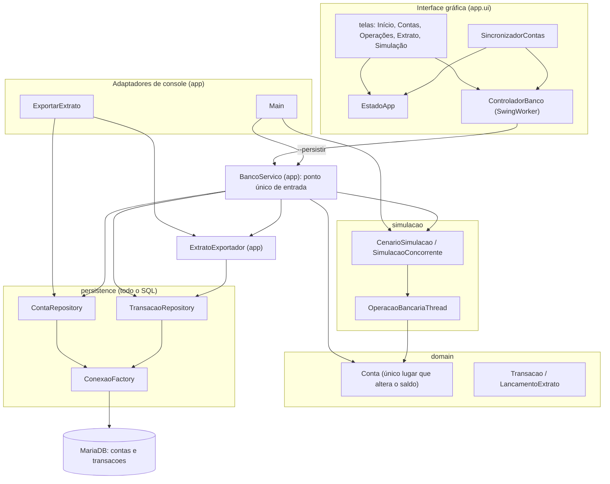
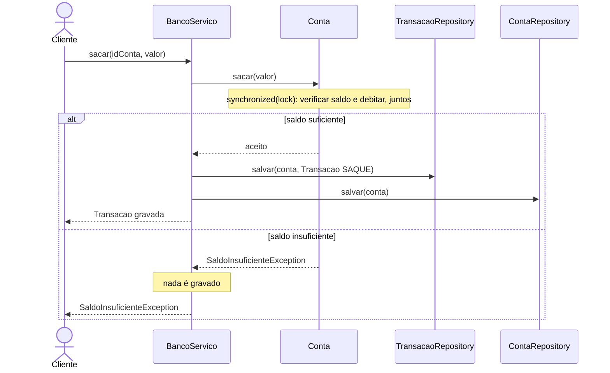
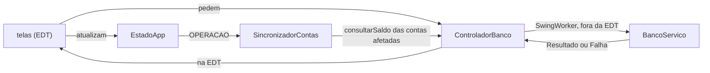
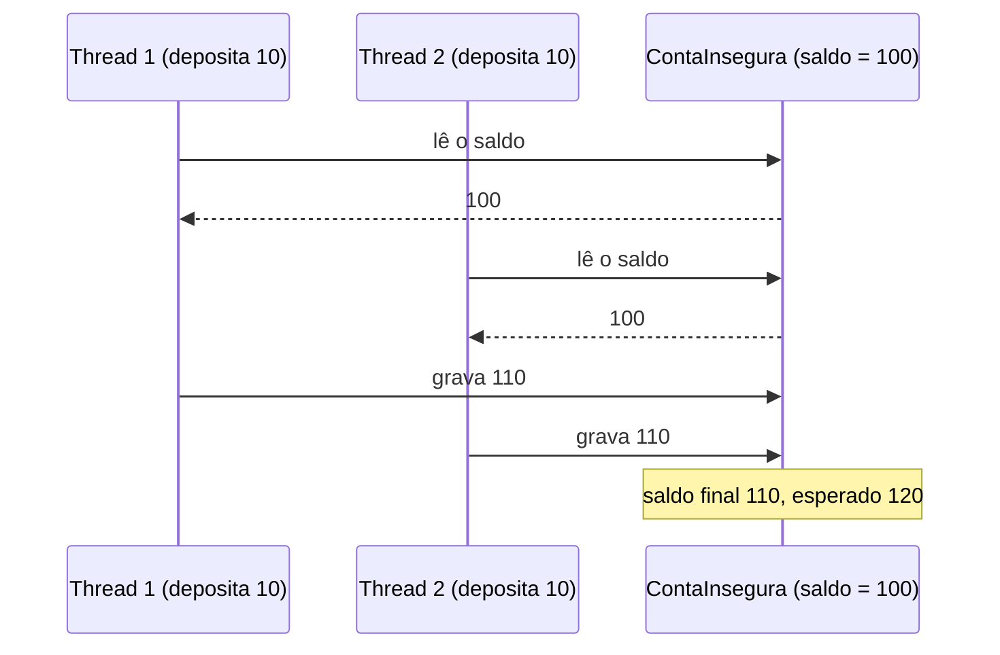
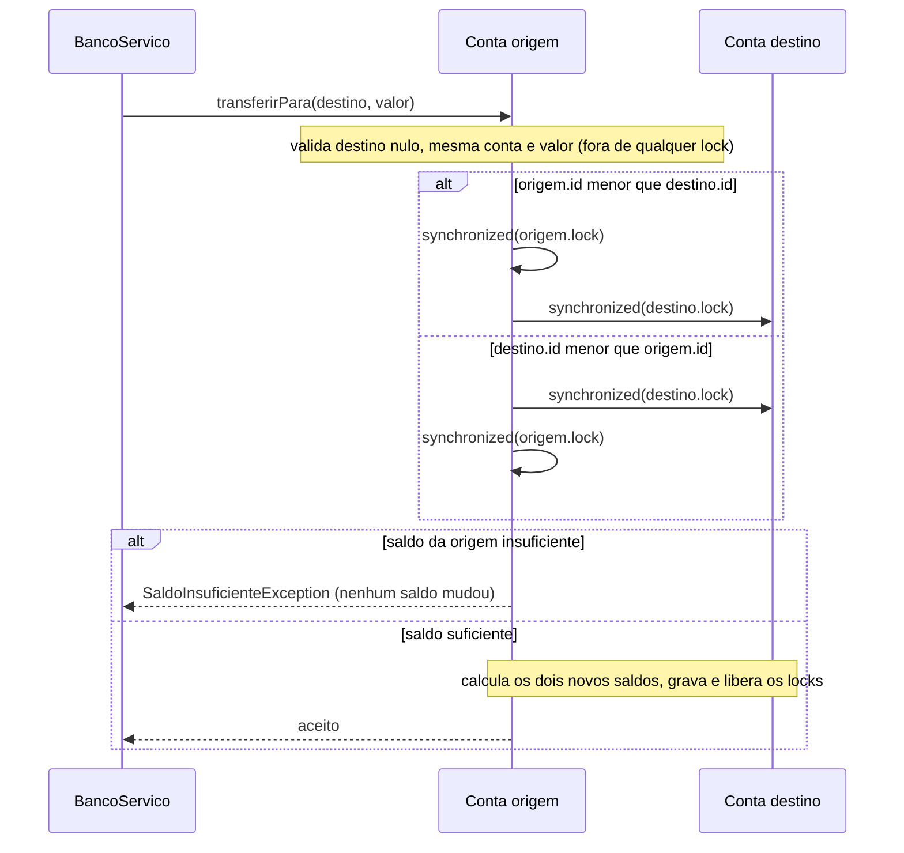
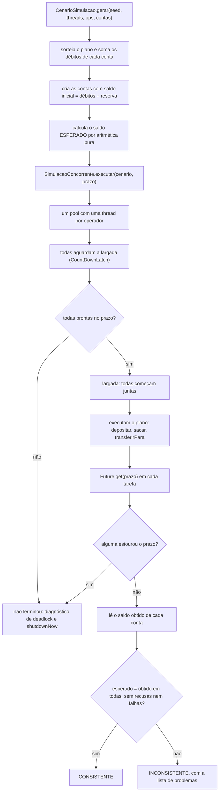
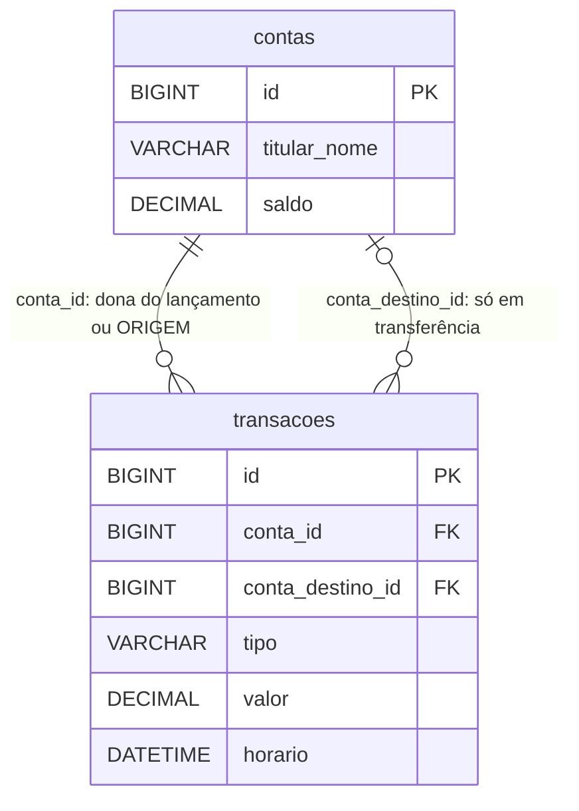

# Sistema Bancário com Transações Concorrentes

Biblioteca, simulador e aplicativo desktop (Swing, marca **Solid Bank**) em Java que modelam contas bancárias
(depósito, saque e transferência) operadas por várias threads ao mesmo tempo. O saldo é protegido por
sincronização, as operações aceitas são persistidas em MariaDB via JDBC puro e o extrato de cada conta pode ser
consultado e exportado para `.txt`.

O projeto tem dois objetivos técnicos:

1. **Corretude sob concorrência:** o saldo final deve ser exatamente o esperado, sem perda de atualização e sem deadlock em transferências cruzadas.
2. **Separação de responsabilidades:** regra de negócio, persistência, simulação e orquestração ficam em camadas distintas, com um único ponto de entrada (`BancoServico`) usado pelas duas interfaces: console (`app.Main`) e gráfica (`app.ui.AppGui`).

## Sumário

- [Funcionalidades](#funcionalidades)
- [Stack](#stack)
- [Estrutura do projeto](#estrutura-do-projeto)
- [Arquitetura](#arquitetura)
- [Primeiros passos](#primeiros-passos)
- [Uso](#uso)
- [Interface gráfica](#interface-gráfica)
- [Testes](#testes)
- [Concorrência](#concorrência)
- [Persistência](#persistência)
- [API do `BancoServico`](#api-do-bancoservico)
- [Decisões de projeto](#decisões-de-projeto)
- [Limitações conhecidas](#limitações-conhecidas)
- [Evidências de execução](#evidências-de-execução)

---

## Funcionalidades

- Criação de contas com saldo inicial e titular.
- Depósito, saque (com recusa por saldo insuficiente) e transferência entre contas.
- Execução concorrente de operações sobre as mesmas contas, com saldo protegido por lock privado por conta.
- Transferências livres de deadlock, por ordenação total dos locks.
- Cada operação aceita gera uma `Transacao` imutável (tipo, valor, horário) gravada no banco; operações recusadas não gravam nada.
- Extrato por conta, com sentido (entrada/saída) e conta relacionada, consultável e exportável em `.txt` (UTF-8).
- Simulador concorrente determinístico (por *seed*) que compara o saldo esperado, calculado por aritmética pura, com o saldo obtido.
- Interface gráfica (Swing) com cinco telas: Início, Contas, Operações, Extrato e Simulação; todo acesso ao banco roda fora da thread de eventos.
- Demonstração isolada da *race condition* (`ContaInsegura`, sem sincronização) para contraste com `Conta`.

## Stack

| Item | Versão |
|---|---|
| Java | 21 ou superior (`release 21`; validado com Java 25) |
| Build | Maven |
| Banco de dados | MariaDB 10.4+ (compatível com MySQL 8.0.16+) |
| Driver JDBC | `mariadb-java-client` 3.5.9 |
| Interface gráfica | Swing (módulo `java.desktop` do JDK, sem dependências extras) |
| Testes | JUnit 5.11.4 |

## Estrutura do projeto

```
src/main/java
├── domain/        Regra de negócio: Conta, Cliente, Transacao, TipoTransacao,
│                  LancamentoExtrato, SaldoInsuficienteException
├── persistence/   Todo o SQL: ConexaoFactory, ContaRepository, TransacaoRepository,
│                  PersistenciaException
├── simulacao/     CenarioSimulacao, SimulacaoConcorrente, OperacaoBancariaThread,
│                  OperacaoPlanejada, ResultadoSimulacao
├── app/           BancoServico (fachada), ExtratoExportador, adaptadores de console
│                  (Main, ExportarExtrato) e DTOs (ContaResumo, ParametrosSimulacao,
│                  ExecucaoSimulacao)
├── app/ui/        Interface gráfica: AppGui (entrada), ControladorBanco (SwingWorker),
│                  EstadoApp, SincronizadorContas, Moeda
│   ├── telas/     JanelaPrincipal, PainelCelular e os painéis Início, Contas, Operações,
│   │              Extrato e Simulação
│   └── tema/      Tema (cores, fontes, medidas), Componentes e Icones (desenhados em Java2D)
└── sim/didatico/  ContaInsegura e DemonstracaoRaceCondition (isolados, ver abaixo)
src/main/resources/schema.sql    Esquema das tabelas
src/main/resources/app/ui/       Brasão e ícone do Solid Bank (PNG)
docs/banco-setup.sql             Criação dos bancos "banco" e "banco_teste"
docs/evidencias/                 Saídas registradas de execuções
```

O pacote `sim.didatico` existe para manter reproduzível a demonstração do cenário **sem** sincronização depois de
`Conta` ter sido corrigida. `ContaInsegura` nunca é usada pelo sistema; somente `DemonstracaoRaceCondition` a instancia.

---

## Arquitetura

Invariantes que o código mantém:

- Somente `Conta` altera o saldo; o saldo e o lock são privados.
- Não há SQL fora de `persistence`.
- `Transacao` é imutável.
- `BancoServico` não usa `synchronized`, `System.out`, `System.exit` nem lê teclado: devolve valores e lança exceções.
- A interface gráfica só fala com `BancoServico`, por meio de `ControladorBanco`; nenhuma tela recebe uma `Conta` (só `ContaResumo`) nem executa chamada ao serviço na thread de eventos.



### Fluxo de uma operação

`BancoServico` chama `Conta` (regra e lock) e **somente se a operação foi aceita** grava a `Transacao` e o saldo.



---

## Primeiros passos

### 1. Banco de dados

```bash
# Cria os bancos "banco" e "banco_teste"
mysql -u <usuario> -p < docs/banco-setup.sql

# Cria as tabelas em cada banco
mysql -u <usuario> -p banco       < src/main/resources/schema.sql
mysql -u <usuario> -p banco_teste < src/main/resources/schema.sql
```

O `schema.sql` é idempotente (`CREATE TABLE IF NOT EXISTS`).

### 2. Credenciais

A conexão é resolvida nesta ordem: propriedade de sistema (`-D`), variável de ambiente, valor padrão.
Nenhuma credencial fica no código-fonte, em `toString()` ou em mensagens de erro.

| Variável de ambiente | Propriedade | Padrão |
|---|---|---|
| `BANCO_URL` | `banco.url` | `jdbc:mariadb://localhost:3306/banco` |
| `BANCO_USUARIO` | `banco.usuario` | `root` |
| `BANCO_SENHA` | `banco.senha` | vazia |

Os testes de integração usam um conjunto separado para nunca tocar no banco real:
`BANCO_TESTE_URL` (padrão `.../banco_teste`), `BANCO_TESTE_USUARIO` e `BANCO_TESTE_SENHA`.

```bash
# Linux/macOS
export BANCO_USUARIO=<usuario>
export BANCO_SENHA=<senha>

# Windows (PowerShell)
$env:BANCO_USUARIO = "<usuario>"; $env:BANCO_SENHA = "<senha>"
```

### 3. Build

```bash
mvn -q compile
mvn -q dependency:build-classpath -Dmdep.outputFile=cp.txt   # o driver JDBC só existe no classpath do Maven
CP="target/classes:$(cat cp.txt)"                            # no Windows, troque ':' por ';'
```

---

## Uso

### Simulação concorrente (`app.Main`)

```
Main [seed] [threads] [operacoesPorThread] [contas] [rodadas] [--persistir]
```

Padrão: `42 8 20000 4 3` (8 threads × 20.000 operações = 160.000 operações sobre 4 contas, em 3 rodadas).

```bash
java -cp "$CP" app.Main                              # em memória, sem banco
java -cp "$CP" app.Main 42 8 20000 4 3 --persistir   # grava as contas ao final
```

Cada rodada gera um cenário novo com a mesma *seed*: o plano de operações e os saldos esperados são idênticos
entre rodadas e execuções; só a intercalação das threads varia. Sem `--persistir`, a simulação não acessa o banco.

| Código de saída | Significado |
|---|---|
| 0 | todas as rodadas consistentes |
| 1 | alguma rodada inconsistente |
| 2 | argumentos inválidos |
| 3 | falha ao gravar no banco (`--persistir`) |

### Demonstração da race condition

```bash
java -cp target/classes sim.didatico.DemonstracaoRaceCondition 10 50000
```

Não precisa de banco nem de driver. Os argumentos são o número de rodadas e de repetições por thread.

### Exportação de extrato

```bash
java -cp "$CP" app.ExportarExtrato <idDaConta> [arquivo.txt]
```

Sem o segundo argumento, grava `extrato-conta-<id>.txt` na pasta atual. É somente leitura: não altera o banco.
Códigos de saída: 0 sucesso · 1 uso incorreto · 2 conta não encontrada · 3 falha de banco ou de arquivo.

Exemplo de saída (layout do `ExtratoExportador`):

```
==========================================================================
EXTRATO DE CONTA
==========================================================================
Conta         : #5
Titular       : Maria Silva
Gerado em     : 12/11/2026 15:24:57
Saldo atual   : R$ 1.070,00
--------------------------------------------------------------------------
DATA/HORA            DESCRIÇÃO                                       VALOR
12/11/2026 15:20:47  Depósito                                  + R$ 200,00
12/11/2026 15:21:13  Saque                                      - R$ 50,00
12/11/2026 15:22:37  Transferência enviada para conta #6        - R$ 80,00
--------------------------------------------------------------------------
Lançamentos   : 3
Total entradas: R$ 200,00
Total saídas  : R$ 130,00
==========================================================================
```

---

## Interface gráfica

Aplicativo desktop em Swing com a marca **Solid Bank**, em formato de celular: janela fixa de 402 × 874 pt
(proporção do iPhone 17 Pro, sem redimensionar). Se a tela não comportar essa altura, a janela encolhe mantendo
a proporção (largura mínima de 300 px). Não exige dependência além do JDK e usa o mesmo `BancoServico` do console.

```bash
java -cp "$CP" app.ui.AppGui      # exige o MariaDB em execução e as credenciais da seção "Credenciais"
```

Se o banco estiver indisponível, o aplicativo abre, o chip do Início mostra "Banco indisponível" e as telas
oferecem "Tentar de novo". O chip só diz "Banco conectado" depois de uma leitura real das contas.

### Telas

Navegação por barra inferior com cinco abas:

| Tela | O que faz |
|---|---|
| Início | Saldo da conta selecionada (com botão de olho para ocultar), seletor de conta, ações rápidas e as últimas 5 movimentações |
| Contas | Lista as contas, define a conta ativa e cria contas novas (nome do titular e saldo inicial) |
| Operações | Depósito, saque e transferência, com campo de valor em pt-BR; a conta aparece num cartão ("Depositando em", "Sacando de", "Pagando com") com o saldo atual; transferência pede também "Transferir para" |
| Extrato | Movimentações da conta agrupadas por data, filtro Todos/Entradas/Saídas e exportação para `.txt` (pede confirmação antes de substituir um arquivo existente) |
| Simulação | Roda a simulação concorrente (threads, operações por thread, contas, seed, prazo e gravação opcional no banco), com botão Encerrar e resultado esperado × obtido por conta |

### Como a interface se liga ao restante



- `ControladorBanco` executa cada chamada em um `SwingWorker` e devolve um `Resultado` (valor ou `Falha`) na thread de eventos. Nenhuma exceção chega às telas: recusas de regra (valor inválido, saldo insuficiente, mesma conta) e falhas técnicas (banco, arquivo) viram mensagens com "o que aconteceu" e "o que fazer", e o detalhe técnico fica recolhido.
- `EstadoApp` guarda as contas carregadas, a conta selecionada e a preferência de ocultar saldo; as telas observam as mudanças (`CONTAS`, `SELECAO`, `SALDO_OCULTO`, `OPERACAO`).
- `SincronizadorContas` lê a lista de contas na abertura e, depois de cada operação confirmada, consulta o saldo das contas envolvidas e o copia para o estado. A tela nunca soma ou subtrai valores por conta própria: o saldo exibido é sempre o devolvido pelo serviço.
- Controles ficam desabilitados durante a chamada (sem envio duplicado). A simulação não tem progresso parcial; o indicador é indeterminado e **Encerrar** cancela o `SwingWorker`, o que interrompe a espera e cancela as threads da simulação.
- A formatação de moeda (`Moeda`, `R$ 1.234,56`) é só de apresentação e tem testes próprios (`MoedaTest`).

---

## Testes

```bash
mvn test                  # 86 testes unitários (exclui @Tag("integracao"))
mvn test -Pintegracao     # 23 testes de integração (exigem MariaDB e o banco "banco_teste")
```

| Camada | Classes | Casos | Foco |
|---|---|---:|---|
| domain | `ContaTest`, `ContaIdPersistenciaTest`, `TransacaoTest` | 22 | regras de saldo, validações, imutabilidade |
| domain | `ContaConcorrenciaTest`, `ContaTransferenciaConcorrenteTest` | 8 | depósitos/saques concorrentes, transferências opostas, ciclo de três contas |
| simulacao | `CenarioSimulacaoTest`, `OperacaoBancariaThreadTest`, `SimulacaoConcorrenteTest` | 14 | plano determinístico, execução, esperado × obtido |
| app | `BancoServicoTest` (repositories falsos), `ExtratoExportadorTest` | 29 | fluxo ponta a ponta sem banco, formatação e exportação |
| app.ui | `MoedaTest` | 9 | formatação e leitura de valores em pt-BR |
| persistence | `ConexaoFactoryTest` | 4 | configuração de conexão |
| persistence | `ContaRepositoryIntegracaoTest`, `TransacaoRepositoryIntegracaoTest`, `BancoServicoIntegracaoTest` | 23 | JDBC real em `banco_teste` (`@Tag("integracao")`) |

Princípios dos testes concorrentes:

- O saldo esperado é calculado **antes** de iniciar qualquer thread, por aritmética pura sobre o plano, sem chamar `Conta`; a referência é independente do código testado.
- O saldo inicial cobre todos os débitos do plano, de modo que nenhuma operação seja recusada.
- Sincronização por `CountDownLatch` e `Future.get` com prazo, sem `sleep` fixo; um deadlock aparece como falha por tempo, não como travamento do build.

> Testes concorrentes que passam são **evidência**, não prova de ausência de *race condition*: a garantia vem do
> desenho (todo acesso ao saldo passa pelo lock) descrito na seção seguinte.

---

## Concorrência

### Race condition e região crítica

`saldo = saldo.add(v)` parece uma instrução, mas são três passos: ler, calcular, gravar. Duas threads podem ler o
mesmo saldo antigo, e a segunda gravação sobrescreve a primeira (atualização perdida).



Em `domain.Conta`, todo acesso ao saldo ocorre dentro de `synchronized (lock)`, em que `lock` é um objeto **privado** de cada
conta. Um lock privado impede que código externo faça `synchronized (conta)` e interfira ou trave as operações, o que
seria possível com `this` ou `Conta.class`. No saque, a verificação do saldo e o débito estão no mesmo bloco; se a
verificação ficasse fora, duas threads poderiam passar nela com o mesmo saldo e sacar mais do que existe.

### Prevenção de deadlock em transferências

Uma transferência precisa dos locks de **duas** contas. Se cada thread travasse primeiro a sua origem, A→B seguraria A
esperando B enquanto B→A seguraria B esperando A. A estratégia, em `Conta.transferirPara`:

1. Cada `Conta` recebe, ao ser criada, um `id` único e imutável, vindo de um `AtomicLong`.
2. Toda transferência trava **sempre a conta de menor `id` primeiro**, independentemente de qual é a origem.
3. Como a ordem é total e igual para todas as threads, não há ciclo de espera, inclusive em cadeias maiores (A→B→C→A).
4. O `id` é um contador, e não `hashCode`/`identityHashCode`, porque estes podem colidir e, numa colisão, a ordem deixaria de ser total.
5. Com as duas contas travadas, verificar o saldo e gravar os dois novos saldos formam uma operação única: não existe débito sem crédito.



Esse `id` (ordem de locks, em memória, reiniciado a cada execução) **não** é o `idPersistencia` (chave primária no banco).

### Simulador



---

## Persistência

### Modelo de dados



- `saldo` e `valor` são `DECIMAL(19,2)`; `horario` é `DATETIME(6)`; `titular_nome` é `VARCHAR(150)`; `tipo` é `VARCHAR(20)`.
- `CHECK (saldo >= 0)` e `CHECK (valor > 0)` como segunda linha de defesa.
- Uma transferência é **uma linha**, com `conta_id` = origem e `conta_destino_id` = destino, e aparece no extrato das duas contas (`SELECT ... WHERE conta_id = ? OR conta_destino_id = ?`).

### Camada JDBC

`ContaRepository` e `TransacaoRepository` concentram todo o SQL, com `PreparedStatement` (SQL parametrizado) e
`try-with-resources` para `Connection`, `PreparedStatement` e `ResultSet`. Falhas viram `PersistenciaException` com a
causa original; nada é engolido. `ConexaoFactory` abre uma conexão nova a cada chamada.

### Exportação do extrato

O texto inteiro é montado em memória **antes** de o arquivo ser aberto. Se o banco falhar, o arquivo existente não é
tocado (`PersistenciaException`); falhas de escrita geram `ExportacaoExtratoException`. A extensão `.txt` é validada e o
diretório de destino é criado quando necessário.

---

## API do `BancoServico`

`app.BancoServico` é o ponto único de entrada para qualquer interface. É thread-safe, e todas as exceções são
não verificadas. A interface nunca recebe a `Conta`, somente `ContaResumo` (somente leitura).

| Operação | Parâmetros | Retorno | Exceções |
|---|---|---|---|
| `criarConta` | `String nomeTitular`, `BigDecimal saldoInicial` | `ContaResumo` | `IllegalArgumentException` (nome vazio, saldo negativo ou com mais de 2 casas), `PersistenciaException` |
| `depositar` | `long idConta`, `BigDecimal valor` | `Transacao` gravada | `IllegalArgumentException` (valor inválido, conta inexistente), `PersistenciaException` |
| `sacar` | `long idConta`, `BigDecimal valor` | `Transacao` gravada | as mesmas, mais `SaldoInsuficienteException` |
| `transferir` | `long idOrigem`, `long idDestino`, `BigDecimal valor` | `Transacao` gravada | as mesmas, mais `IllegalArgumentException` se origem = destino |
| `consultarSaldo` | `long idConta` | `BigDecimal` (saldo em memória) | `IllegalArgumentException`, `PersistenciaException` |
| `listarContas` | nenhum | `List<ContaResumo>` | `PersistenciaException` |
| `consultarExtrato` | `long idConta` | `List<LancamentoExtrato>` (cronológico, com sentido) | `IllegalArgumentException`, `PersistenciaException` |
| `exportarExtrato` | `long idConta`, `Path caminhoTxt` | `Path` gravado | `IllegalArgumentException` (sem `.txt`), `PersistenciaException`, `ExportacaoExtratoException` |
| `executarSimulacao` | `ParametrosSimulacao` | `ExecucaoSimulacao` (contém o `ResultadoSimulacao` e as contas gravadas) | `IllegalArgumentException`, `InterruptedException`, `PersistenciaException` |

Notas para quem integrar uma interface (a gráfica deste projeto, `app.ui`, já segue todas elas; vale também para JavaFX ou web):

- As chamadas fazem JDBC, escrevem arquivo ou rodam a simulação (segundos): **não** as execute na thread de eventos da UI.
- Após uma operação, consulte o saldo ao serviço em vez de somar ou subtrair na tela.
- Se `PersistenciaException` ocorrer depois de uma operação, o saldo em memória **já mudou**; consulte o estado antes de tentar de novo.
- `PersistenciaException` está no pacote `persistence`; na interface gráfica, `ControladorBanco` a traduz em uma `Falha` com mensagem de usuário. Uma camada de visão que não possa importar esse pacote precisará de uma exceção de aplicação equivalente.

---

## Decisões de projeto

| Decisão | Onde |
|---|---|
| Saldo e valores em `BigDecimal` com 2 casas decimais | `Conta` |
| Valor com mais de 2 casas é recusado (`IllegalArgumentException`), nunca arredondado em silêncio | `Conta`, `TransacaoRepository` |
| Transferir para a própria conta é recusado | `Conta.transferirPara` |
| Operação inválida lança exceção antes de qualquer alteração de saldo | `Conta` |
| Tipos de transação: `DEPOSITO`, `SAQUE`, `TRANSFERENCIA` | `TipoTransacao` |
| `Cliente` guarda apenas o nome | `Cliente` |
| Saldo inicial não gera lançamento no extrato | `BancoServico` |
| Layout do extrato: cabeçalho, um lançamento por linha (`+` entrada, `-` saída), resumo; valores `R$ 1.234,56`; UTF-8 | `ExtratoExportador` |
| `BancoServico` mantém uma única instância de `Conta` por `idPersistencia` (mapa thread-safe) | `BancoServico` |

### `Main --persistir`

Gravar uma `Transacao` por operação da simulação seriam cerca de 160.000 linhas por rodada, cada uma com uma conexão nova.
Por isso `--persistir` grava **somente as contas, com o saldo final**, ao final da última rodada, depois de todas as
threads terminarem e somente se a rodada foi consistente. Consequência: o extrato dessas contas fica vazio, porque o
saldo gravado não corresponde a lançamentos. Uma alternativa seria gravar um resumo agregado por conta e tipo, ao custo
de criar lançamentos que não são operações reais.

---

## Limitações conhecidas

- **Gravação em duas etapas, sem transação JDBC conjunta.** Gravar a `Transacao` e atualizar o saldo são instruções separadas, sem `commit` conjunto. Se o banco falhar entre as duas, a `Transacao` fica gravada e o saldo da linha, defasado; o serviço lança `PersistenciaException` informando que a operação foi aceita em memória, mas não foi gravada por completo. Correção possível: métodos nos repositories que recebam a mesma `Connection` e façam `commit`/`rollback` das duas gravações.
- **Uma instância de `Conta` por linha.** `ContaRepository.buscarPorId` cria um objeto novo a cada chamada, e cada objeto tem o seu lock; duas instâncias da mesma linha não se sincronizam. `BancoServico` resolve isso com seu registro de contas abertas, o que pressupõe **um único processo** usando o banco.
- **O saldo gravado é um instantâneo.** `ContaRepository.salvar` grava o que `getSaldo()` devolve naquele instante, fora do lock da `Conta`. Com várias threads na mesma conta, dois `UPDATE` podem executar fora da ordem das operações e a linha ficar defasada até a próxima gravação. Durante o uso, o saldo em memória (`consultarSaldo`) é a fonte de verdade.
- **Ordem e horário do extrato.** Pelo mesmo motivo, sob concorrência na mesma conta, o horário e a ordem dos lançamentos podem divergir levemente da ordem real de execução.
- **Contas carregadas ficam em memória** até o serviço ser descartado.
- **Cada operação abre uma conexão nova** (sem *pool*).

---

## Evidências de execução

Saídas completas, com comando, data e ambiente no cabeçalho, estão em `docs/evidencias/`.

**Sem sincronização** (`ContaInsegura`; 4 threads depositam R$ 10,00 e 4 sacam R$ 5,00, 50.000 vezes cada, sobre a mesma conta; saldo inicial R$ 1.000.000,00; esperado **R$ 2.000.000,00**; Java 25.0.2, 16 núcleos): em **10 de 10 rodadas** o saldo divergiu, com valores entre R$ 785.105,00 e R$ 1.485.535,00. O controle sequencial (1 thread) deu o valor esperado. A divergência não é garantida a cada rodada, pois depende do escalonamento; em máquinas com menos núcleos, rodadas isoladas coincidiram com o esperado (arquivos históricos em `docs/evidencias/`). Arquivo: `race-condition-antes-REAL.txt`.

**Com `Conta` sincronizada** (`app.Main 42 8 20000 4 3`; 160.000 operações: 64.106 depósitos, 47.931 saques, 47.963 transferências; mesmo ambiente): 3 de 3 rodadas consistentes, 0 operações recusadas, 0 threads com falha. Arquivo: `simulacao-REAL.txt`.

| Conta | Esperado (R$) | Obtido (R$) | Diferença |
|---|---:|---:|---:|
| Titular 1 | 1.419.233,44 | 1.419.233,44 | 0,00 |
| Titular 2 | 1.408.560,81 | 1.408.560,81 | 0,00 |
| Titular 3 | 1.431.835,16 | 1.431.835,16 | 0,00 |
| Titular 4 | 1.421.208,96 | 1.421.208,96 | 0,00 |
| **Total** | **5.680.838,37** | **5.680.838,37** | **0,00** |

**Suíte de testes** `mvn test` → 86 testes, 0 falhas (`mvn-test-REAL.txt`); `mvn test -Pintegracao` → 23 testes, 0 falhas (`mvn-integracao-REAL.txt`). Desde então foi acrescentado `MoedaTest` (9 casos), que eleva a suíte unitária a 86.

O mesmo volume de operações que corrompe o saldo em `ContaInsegura` fica exato em `Conta`. Os arquivos
`testes-concorrencia-*.txt` são anteriores e foram gerados por um executor improvisado; ficam apenas como histórico.
